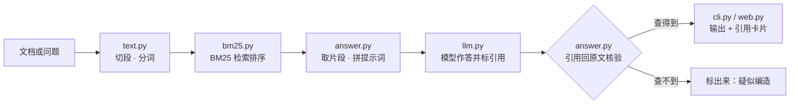

# Zhiku · Local Knowledge Base Q&A

[](https://github.com/wushiyi105-jpg/zhiku/actions) []() [](./LICENSE) [](https://codecov.io/gh/wushiyi105-jpg/zhiku)

Drop your own documents in, ask questions. The answer is not "looks about right" — every sentence carries a `[1]` that jumps back to the exact line in the source.

This is the fifth thing I built. The first four (cooking, bookkeeping, meeting notes, deep research) shared one flaw: they were good at *talking*, but you had no way to check whether what they said was true. So I went the other direction — shut the model up, let it only find answers inside the material you gave it, and let it say "not found" when there is nothing.


## What it is

A local knowledge base. You hand it txt / md / html / csv, it chunks and indexes them. You ask a question, it retrieves first, feeds the most relevant passages to the model, and requires a citation on every sentence. Then it checks the model itself: citations that point at nothing get dropped, citations whose surrounding text does not match the source get flagged.

No vector database, no embedding service, no frontend framework. The whole thing depends on the Python standard library only — `python -m zhiku` runs.

## Features

- **Answers carry citations, citations jump back.** Each citation stores the character range in the source (characters 1234–1500). The Web endpoint jumps straight to that sentence, so you do not have to scroll a long document yourself.
- **No making things up.** If the material does not contain it, the model is told to output `INSUFFICIENT`, which the program turns into plain language: "The material has nothing that answers this. I am not inventing one."
- **Citation verification.** Models love to slap on a `[3]` that does not exist. This checks whether the index is real; it also compares the 60 characters around `[n]` against the cited passage and flags a mismatch when the wording overlap is too low.
- **Zero-dependency retrieval.** A BM25 I wrote myself, Chinese tokenised as single characters plus bigrams. Good enough, and I can change it without reading someone else's docs.
- **Both CLI and Web.** The command line suits batch imports; the Web UI suits reading citations while asking follow-ups.
- **Data stays local.** One SQLite file, `data/zhiku.db`. Delete it and everything is gone. Nothing syncs to a cloud.

## Quick start

```bash
git clone https://github.com/wushiyi105-jpg/zhiku.git
cd zhiku
cp .env.example .env        # Windows: copy .env.example .env
# open .env and put in your own LLM_API_KEY
```

Import the two sample documents and ask one question:

```bash
python -m zhiku add samples/员工手册.md samples/云盘产品答疑.md
python -m zhiku ask "报销最晚多少天内必须提交？超过会怎样？"
```

Output looks roughly like this:

```
结论：报销应在费用实际发生后 15 天内提交 [1]。
超过 30 天的单据，财务不再受理 [1]。
依据：材料只明确超过 30 天不受理；超过 15 天但未超过 30 天之间的后果未说明 [1]。

[1] 青梧科技员工手册（2026 版） · 第 0-676 字
    # 青梧科技员工手册（2026 版） …（按住 ctrl 点引用可跳回原文）
```

Start the Web UI:

```bash
python -m zhiku serve          # http://127.0.0.1:8765
```

Import on the left, ask on the right; citation cards come out together with the answer.

Run in Docker (the container uses the default port 8765):

```bash
docker build -t zhiku .
docker run -p 8765:8765 zhiku
```

## Command reference

| Command | What it does |
| --- | --- |
| `python -m zhiku add <文件...>` | Import documents; importing the same path again replaces the old version |
| `python -m zhiku ask "问题"` | Retrieve + answer; `--json` gives structured output |
| `python -m zhiku list` | List the documents in the library |
| `python -m zhiku rm <id或路径>` | Delete one |
| `python -m zhiku stats` | Document / chunk / character counts, number of questions |
| `python -m zhiku history` | What was asked recently |
| `python -m zhiku serve --port 8765` | Start the Web UI |

Shared flags: `--db data/zhiku.db` switches the database file; `add --size 700 --overlap 80` adjusts chunk size and overlap.

## 🤔 Why not just ask a general LLM

A general model that has read your documents answers fluently. Zhiku adds the four things it cannot:

1. **Citations jump back** — every citation records the character range in the source (characters 1234–1500), so the Web endpoint jumps straight to that line and the CLI shows the source too. A chat summary has no coordinates to verify.
2. **No invention** — when the material does not contain the answer, the model must output `INSUFFICIENT`, which the program translates into "the material has nothing that answers this, I will not make it up". A citation number that does not exist, or an `[n]` whose surrounding 60 characters barely overlap the source, gets flagged.
3. **Retrieval stays local** — a hand-written BM25 (Chinese split into single characters plus bigrams) runs on this machine, with documents and index in `data/zhiku.db`, behind no search service; a model call sends only the matched passages.
4. **Structured output** — answer, citation numbers, character ranges and word-overlap scores are fixed fields, and `--json` supports further processing. A chat reply is prose you can only audit with your eyes.

## 🎯 Use cases

- **Looking up a company policy**: import the handbook and expense rules, ask "how many days do I have to submit a reimbursement", and the answer carries `[1]` that opens the exact paragraph — no more scrolling a PDF.
- **Checking product answers before replying**: load the FAQ and support scripts, ask first, and quote the sourced basis instead of misremembering a policy.
- **Comparing specifications**: put several specs in one library, ask how a clause is worded, and hand the cited range to a colleague.

## 🗺 Roadmap

- **Incremental indexing and deletion**: rebuild only changed documents and clear index entries when a document is removed.
- **Separate knowledge bases**: one library per project so material does not leak into another project's answers.
- **PDF/Word text extraction**: extract plain text locally before indexing, instead of copy-pasting.
- **Citation highlighting**: not just jumping to the range but highlighting those characters in the Web UI.
- **Retrieval evaluation set**: a set of question-to-document pairs to regress against when tuning retrieval.

## ❓ FAQ

**Where do I get an API key?**
The project ships without one. It talks to DeepSeek (`https://api.deepseek.com`) by default — set `LLM_API_KEY`. Zhipu, OpenAI and a local Ollama work too via `LLM_BASE_URL` and `LLM_MODEL`.

**Where is data stored, and is it uploaded?**
In `data/zhiku.db`: documents, chunks and index stay on this machine. A model call sends the retrieved passages and the question, not the library.

**Does it work without a key?**
You can still retrieve and see the matched source passages with their character ranges; it will not compose an answer for you. A key is needed only for the written answer.

**How do I switch models?**
Change the three environment variables, or override per run with `--model`; switching endpoints needs no code change.

**Why does it say the material has nothing?**
Because the retrieved passages genuinely contain no basis. It does not guess or borrow from an adjacent topic; add the relevant document and ask again.

## How it works

Four steps, each testable on its own:

1. **Chunking.** Split on blank lines, accumulate passages to roughly 700 characters, keep 80 characters of overlap between chunks (so a sentence spanning a paragraph break is not cut). Each chunk records its start and end character offsets in the source.
2. **Retrieval.** BM25 scoring. Terms are Chinese single characters plus adjacent bigrams, with single-character weight pushed down to 0.3 — without that, "的/是/在" lift the score of every passage. Any passage that matches none of the query bigrams is dropped outright.
3. **Answering.** The top 6 passages, numbered, go into the prompt, with rules written in: use only this material, cite `[n]` on every sentence, output `INSUFFICIENT` when there is no answer, point out contradictions between passages.
4. **Verification.** Parse the `[n]` markers in the answer, drop the out-of-range ones with a note; then recompute the word-overlap between the text around `[n]` and the cited passage, and flag it when the overlap is too low.


### Data flow

How one piece of data moves between the modules:



## Layout

```
zhiku/
├── zhiku/
│   ├── text.py      read files, clean, chunk, tokenise
│   ├── bm25.py      BM25 scoring and query
│   ├── store.py     SQLite access (documents / chunks / questions)
│   ├── answer.py    retrieve → prompt → citation verification
│   ├── llm.py       OpenAI-compatible client (urllib only)
│   ├── cli.py       command line
│   └── web.py       http.server page + JSON endpoints
├── samples/         two sample documents
├── tests/           42 offline unit tests
├── scripts/         usage GIF generator (dev only, needs Pillow)
└── assets/demo.gif
```

## Tests

```bash
python -m unittest discover -s tests -v
```

42 cases, all offline: no network, no tokens spent. Model calls are mocked, covering chunk offsets, BM25 ranking, SQLite CRUD, out-of-range / missing / mismatched citations, and the four Web endpoints.

CI runs Python 3.10–3.13, see the badge above.

## Things I got wrong

**`min_score=1.0` was a guess, and it filtered out every short query.** In one document "住宿" appeared in exactly one passage, BM25 scored about 0.98, a hair under the threshold, so asking "who pays for an over-budget hotel" came back "not in the library". A threshold should never be an absolute score — change the corpus and the score distribution changes. The fix: require at least one query bigram to hit, and use the score only for ordering.

**A SQLite connection cannot cross threads.** `ThreadingHTTPServer` gives each request a thread, and they shared one connection; the first version died with `ProgrammingError: SQLite objects created in a thread can only be used in that same thread`. The fix is `check_same_thread=False` plus a lock, so all reads and writes queue up.

**deepseek-flash sometimes returns an empty body.** Reasoning tokens ate the whole budget and `content` came back empty. The client has a fallback: if `finish_reason=length` and the body is empty, double `max_tokens` and retry once (capped at 8000).

**The model does not like citing.** Even written into the prompt, it occasionally forgets. I do not pretend that is fine — the answer gets an extra line: "the model did not cite this part; the most relevant passage has been attached, please check it yourself".

## Author

shiyi · wushiyi105@gmail.com · [@wushiyi105-jpg](https://github.com/wushiyi105-jpg)

## License

MIT
