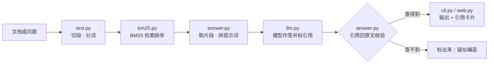

# 知库 · Zhiku

[](https://github.com/wushiyi105-jpg/zhiku/actions) []() [](./LICENSE) [](https://codecov.io/gh/wushiyi105-jpg/zhiku)

[](https://github.com/wushiyi105-jpg/zhiku/actions/workflows/test.yml)

把一堆自己的文档丢进去，问它问题。答案不是"看起来很对"，而是每句话后面都挂着 `[1]`，点一下就能跳回原文那一行。

这是我做的第 5 个东西。前四个（做饭、记账、会议纪要、深度研究）都有一个共同毛病：它们很会"说"，但你没法核对它说的对不对。所以这次我换了个方向——让模型闭嘴，只在给定材料里找答案，找不到就说找不到。


## 它是什么

一个本地知识库。你给它 txt / md / html / csv，它切块、建索引；你问问题，它先检索，再把最相关的几段喂给模型，要求模型每句都标出处；最后它自己再核一遍，模型引用了不存在的编号会被剔掉，引用的段落跟答案词面对不上会标黄提醒。

没有向量数据库，没有 embedding 服务，没有前端框架。整个项目只依赖 Python 标准库，`python -m zhiku` 就能跑。

## 特性

- **答案带引用，引用能回跳**：每条引用记着原文的字符区间（第 1234–1500 字），Web 端点一下就定位到原句，不用自己在长文档里翻。
- **不许编**：材料里没有的，模型被要求只输出 `INSUFFICIENT`，程序翻译成人话——"材料里没有能回答这个问题的内容，我不编。"
- **引用核验**：模型爱瞎标 `[3]`，这里会检查编号是否存在；还会比对 `[n]` 前后 60 字和那段材料的词面重合度，太低就标「词面对不上，建议核对」。
- **零依赖检索**：自己写的 BM25，中文按「单字 + 二元组」切。够用，而且改起来不用读别人的文档。
- **CLI 和 Web 都在**：命令行适合批量导入，Web 适合一边看引用一边追问。
- **数据在本地**：一个 SQLite 文件，`data/zhiku.db`，删了就是全删，不联云。

## 快速开始

```bash
git clone https://github.com/wushiyi105-jpg/zhiku.git
cd zhiku
cp .env.example .env        # Windows: copy .env.example .env
# 打开 .env，把 LLM_API_KEY 换成你自己的
```

导入两篇示例文档，问一句：

```bash
python -m zhiku add samples/员工手册.md samples/云盘产品答疑.md
python -m zhiku ask "报销最晚多少天内必须提交？超过会怎样？"
```

跑出来大概是这样：

```
结论：报销应在费用实际发生后 15 天内提交 [1]。
超过 30 天的单据，财务不再受理 [1]。
依据：材料只明确超过 30 天不受理；超过 15 天但未超过 30 天之间的后果未说明 [1]。

[1] 青梧科技员工手册（2026 版） · 第 0-676 字
    # 青梧科技员工手册（2026 版） …（按住 ctrl 点引用可跳回原文）
```

起 Web 界面：

```bash
python -m zhiku serve          # http://127.0.0.1:8765
```

左边导入、右边提问，引用卡片会跟着答案一起出来。

Docker 运行(容器内用默认端口 8765):

```bash
docker build -t zhiku .
docker run -p 8765:8765 zhiku
```

## 命令参考

| 命令 | 作用 |
| --- | --- |
| `python -m zhiku add <文件...>` | 导入文档，同一路径再导入会覆盖旧版本 |
| `python -m zhiku ask "问题"` | 检索 + 作答，`--json` 输出结构化结果 |
| `python -m zhiku list` | 看库里有哪些文档 |
| `python -m zhiku rm <id或路径>` | 删一篇 |
| `python -m zhiku stats` | 文档数 / 段数 / 字数 / 提问次数 |
| `python -m zhiku history` | 最近问过什么 |
| `python -m zhiku serve --port 8765` | 起 Web |

通用参数：`--db data/zhiku.db` 换库文件；`add --size 700 --overlap 80` 调切块长度与重叠。

## 🤔 为什么不用通用大模型直接问

通用模型读过你的文档后能答得很顺,但知库补的是它做不到的四件事:

1. **引用能回跳** —— 每条引用记着原文的字符区间(第 1234–1500 字),Web 端点一下就跳回那一行,CLI 里也能看到出处;通用模型的总结没有坐标,你没法核对。
2. **不许编** —— 材料里没有的内容,模型被要求只输出 `INSUFFICIENT`,程序翻译成「材料里没有能回答这个问题的内容,我不编」。引用编号不存在、或 `[n]` 前后 60 字与原文词面重合度过低,都会被标出来。
3. **检索在本地** —— 自写的 BM25(中文按单字 + 二元组切)跑在本机,文档和索引存 `data/zhiku.db`,不经过任何检索服务;调模型时只发命中的那几段。
4. **结构化输出** —— 答案、引用编号、字符区间、词面重合度都是固定字段,`--json` 可以直接做二次处理;通用对话是一段话,想批量核对只能人眼扫。

## 🎯 适用场景

- **公司制度查条款**:把员工手册、报销制度导进去,问「报销最晚多少天内提交」,答案后面挂 `[1]`,点开就是原文那一段,不用再翻 PDF。
- **产品答疑自己先查**:客服话术、FAQ 文档入库后,写回复前先问一遍,拿到带出处的依据,避免记错政策。
- **合同/规范比对**:几份规范放一起,问某一条怎么规定,答案带区间,能直接引给同事看。

## 🗺 Roadmap

- **增量索引与删除**:文档改动后只重建变化的部分,删文档时同步清索引。
- **多知识库隔离**:按项目分库,避免一份材料串到另一个项目的问答里。
- **PDF/Word 文本抽取**:先在本地抽成纯文本再入库,减少手工复制。
- **引用高亮接口**:Web 里点引用不只跳转,还高亮那一段字符。
- **检索评测集**:准备一组「问题 → 应命中文档」的样例,改检索参数时能回归。

## ❓ FAQ

**API key 从哪来?**
项目不带 key。默认接 DeepSeek(`https://api.deepseek.com`),注册后填 `LLM_API_KEY`;也支持智谱、OpenAI、本地 Ollama,改 `LLM_BASE_URL` 与 `LLM_MODEL` 即可。

**数据存在哪,会上传吗?**
默认 `data/zhiku.db`,文档、切片、索引都在本机;调模型时只发送检索命中的段落和问题,不发整库。

**没有 key 能不能用?**
能检索、能看到命中的原文段落和字符区间,但不会替你组织成答案。要成段的回答才需要模型。

**怎么换模型?**
改三个环境变量,或在命令上加 `--model` 临时覆盖;换端点不用改代码。

**为什么它说「材料里没有」?**
因为检索到的段落里确实找不到依据。这时它不猜,也不会拿相邻话题凑答案;补一份对应文档再问,通常就有了。

## 工作原理

四步，每步都能单独测：

1. **切块**：按空行分段，把段落攒到 700 字左右，块间留 80 字重叠（跨段的话不至于被切断）。每块记下它在原文里的起止字符。
2. **检索**：BM25 打分。词项是中文单字 + 相邻二元组，单字权重压到 0.3——不压的话"的/是/在"会把所有段落的分都抬起来。查询里的二元组一个都没命中的段落直接扔掉。
3. **作答**：把 top 6 段编号塞进 prompt，规则写死：只能用材料、每句标 `[n]`、没有就说 `INSUFFICIENT`、材料互相矛盾要指出来。
4. **核验**：解析答案里的 `[n]`，越界的剔掉并提示；再算一遍 `[n]` 前后文字与材料的词面重合，太低标黄。

### 数据流

一条数据在这几个模块之间怎么走：



## 目录结构

```
zhiku/
├── zhiku/
│   ├── text.py      读文件、清洗、切块、分词
│   ├── bm25.py      BM25 打分与查询
│   ├── store.py     SQLite 存取（documents / chunks / questions）
│   ├── answer.py    检索 → prompt → 引用核验
│   ├── llm.py       OpenAI 兼容客户端（零依赖 urllib）
│   ├── cli.py       命令行
│   └── web.py       http.server 页面 + JSON 接口
├── samples/         两篇示例语料
├── tests/           42 个离线单测
├── scripts/         生成示例 GIF（开发期用，需 Pillow）
└── assets/demo.gif
```

## 测试

```bash
python -m unittest discover -s tests -v
```

42 个用例，全部离线：不联网、不花 token。模型调用在测试里被 mock 掉，覆盖了切块偏移、BM25 排序、SQLite 增删改查、引用越界/缺失/词面对不上、Web 的四个接口。

CI 跑 Python 3.10–3.13 四个版本，见上方徽章。

## 几个踩过的坑

**`min_score=1.0` 是拍脑袋定的，结果短查询全被过滤了。** 一篇文档里"住宿"只出现在一段，BM25 分大概 0.98，差一点点就掉到阈值下面，于是问"住宿超标谁出钱"得到"库里没有"。阈值本来就不该按分数绝对值定——语料一变分数分布就变。后来改成「查询里的二元组至少命中一个」，分数只用来排序。

**SQLite 连接不能跨线程。** `ThreadingHTTPServer` 每个请求一个线程，共用一个连接，第一版直接 `ProgrammingError: SQLite objects created in a thread can only be used in that same thread`。修法是 `check_same_thread=False` 加一把锁，所有读写排队。

**deepseek-flash 偶尔回空正文。** 推理 token 把预算吃完了，`content` 是空字符串。客户端里做了兜底：`finish_reason=length` 且正文为空，就把 `max_tokens` 翻倍再试一次（上限 8000）。

**模型不爱标引用。** prompt 里写死了它还是偶尔忘。忘标的时候我不假装没事，而是在答案下面加一行"模型这段没标引用，已按最相关的一段挂上，请自行核对"。

## 作者

shiyi · wushiyi105@gmail.com · [@wushiyi105-jpg](https://github.com/wushiyi105-jpg)

## License

MIT

